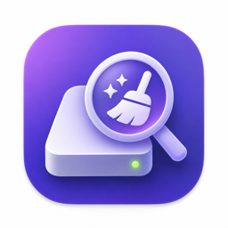
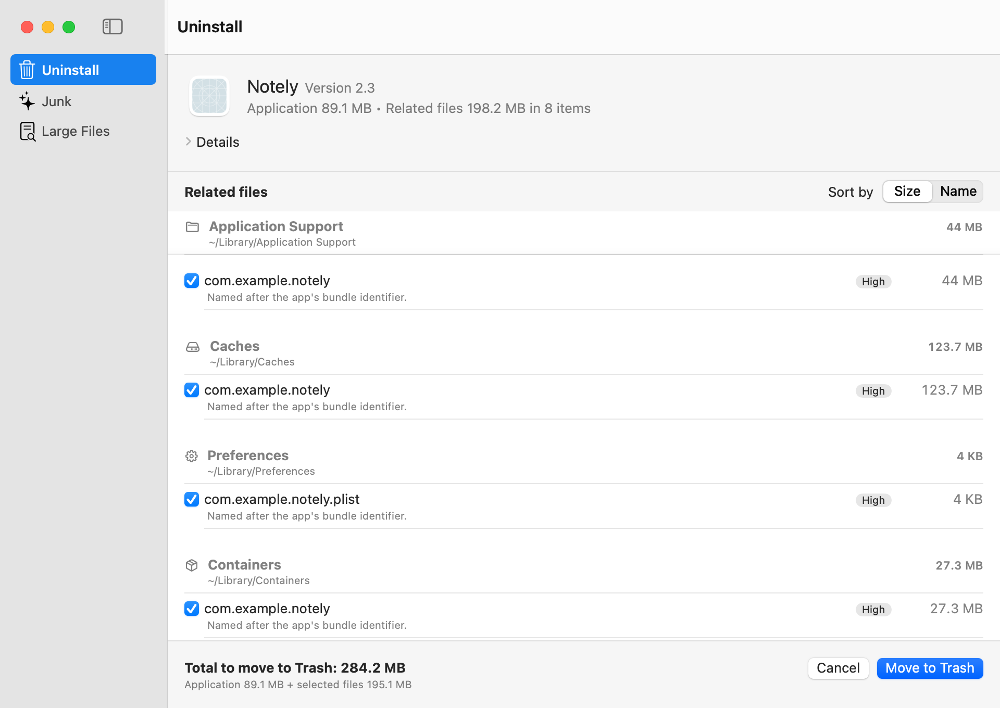
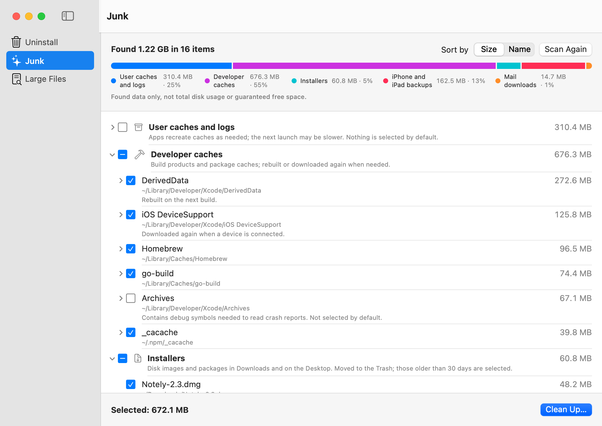
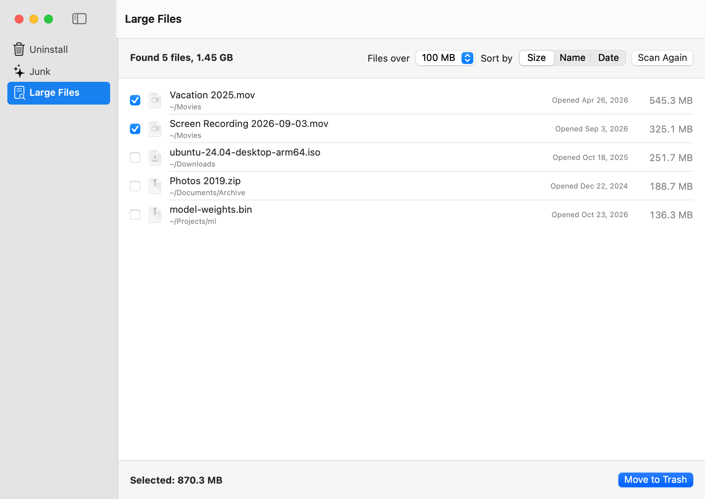

<p align="center">
  
</p>

<h1 align="center">DiskSift</h1>

<p align="center">
  A small native macOS app that uninstalls apps without leaving junk behind, cleans up caches and other junk, and finds large files you forgot about.
</p>

<p align="center">
  <a href="../../releases/latest">Download the latest release</a> · macOS 14 or later · Apple silicon and Intel · English and Russian
</p>



| Junk | Large files |
|---|---|
|  |  |

*Screenshots use a demo home folder.*

Design notes and implementation plans are in [`docs/plans/completed/`](docs/plans/completed/).

## What it does

**Uninstall apps completely.** Drag an app from `/Applications` or `~/Applications` into the window, or click **Choose Application…**. DiskSift reads its bundle ID, Team ID and bundled helpers, then looks for what the app left in your Library:

- preferences, Application Support, caches, logs, saved state, HTTP storage, WebKit data, cookies
- sandbox containers and group containers
- launch agents and daemons that point into the app
- files installed by the app's `.pkg` installer (from `pkgutil` receipts)

Leftovers are grouped by location (Application Support, Caches, Preferences, Login Services and so on), and each one says why it matched and whether other apps may share it. The header shows the app's icon, version and size, plus the total that will go to the Trash. Every finding shows its size and how sure DiskSift is that it belongs to the app. Matches by bundle ID are checked by default. Matches by app name only, and data the vendor's other apps share (for example Office's group container), are left unchecked for you to review. DiskSift unloads the app's launch agents, then moves the app and the checked leftovers to the Trash, so you can put anything back.

**Find leftovers of apps you already deleted.** Dragged an app to the Trash some time ago? **Find Leftovers of Removed Apps…** on the Uninstall screen looks through your Library for preferences, caches, Application Support, containers, saved state, logs and web data named after apps that are no longer installed, plus launch agents whose program is gone. The search is cautious: anything an installed or running app (or one of its helpers or extensions) may own is left out, Group Containers are not touched, and nothing is selected for you. Leftovers are grouped by app and moved to the Trash; launch agents are unloaded first.

**Clean up junk.** One scan shows how much space these take:

- user caches and logs (`~/Library/Caches`, `~/Library/Logs`)
- developer junk: Xcode DerivedData, Archives, iOS DeviceSupport, simulator caches, Homebrew, npm, pip, cargo and Go caches
- installers: `.dmg`, `.pkg`, `.mpkg` and `.xip` files directly in Downloads and on the Desktop
- local iPhone and iPad backups (one row per device, with its name and backup date)
- Mail downloads: attachments Mail saved when you opened them

User caches and logs start unchecked: pick what you want to delete. Developer caches start checked, except Xcode Archives (they hold dSYMs). Caches, logs and Mail downloads are rebuilt or downloaded again when needed, so they are deleted permanently and the space is freed right away. Installers and device backups are moved to the Trash instead. Installers older than 30 days start checked; backups never do, since a backup can be the only copy of a device's data. Without Full Disk Access, backups and Mail downloads show "No access" instead of a size.

**Find large files.** A third tab lists files of 100 MB, 500 MB, 1 GB or 5 GB and more anywhere in your home folder, with the date each was last opened (from Spotlight; otherwise the date it was modified). Nothing is selected by default. Files you select are moved to the Trash, never deleted. The scan skips `~/Library`, the Trash, `~/Applications`, apps and media libraries, Git folders and other volumes.

**Remove Neural DSP plugins.** Neural DSP ships no uninstaller: each plugin is spread over the AU, VST, VST3 and AAX folders, the standalone app in `/Applications/Neural DSP`, presets, a manual, your settings and seven installer receipts. The **Plugins** tab finds them all, groups them by plugin and shows what removed plugins left behind (for example a manual and settings without the plugin). Bundles in the shared plug-in folders count only when their bundle ID is Neural DSP's, so other vendors' plugins never show up. Nothing is selected by default; checking a plugin selects all its parts except presets that hold your own presets (the `User` folder). Parts you can remove yourself (settings, often the manual) go to the Trash. Plugin bundles, the app and other root-owned parts are deleted permanently after one macOS administrator password prompt, which also removes the matching installer receipts. Cancelling the prompt removes nothing.

Right-click any item for **Show in Finder** or **Copy Path**. When something can't be removed, the report says why and what to do next.

Sizes are allocated sizes on disk. Because of APFS clones and local Time Machine snapshots, the space actually freed can be smaller. The Junk tab and the report after a cleanup that deletes files show how many local snapshots the disk has and how old the oldest one is; macOS removes them on its own within 24 hours or when space runs low. DiskSift does not delete snapshots, since that needs administrator rights.

## Safety

- DiskSift only removes items inside a fixed list of folders: the Library folders it scans, `/Applications`, `~/Applications` and known developer cache folders, never those folders themselves. Anything else, such as iCloud Drive, cloud storage, Mail or Keychains, is refused, whatever the UI asks for.
- Large files in your home folder go through a separate, stricter scope. DiskSift only moves them to the Trash, never deletes them permanently, and only individual files, never folders or symlinks. It never touches `~/Library`, `~/.Trash`, `~/Applications`, anything inside a package (apps, Photos and Music libraries, Final Cut and Logic projects, virtual machines, sparse bundles) or a `.git` folder, or anything on another volume mounted inside your home folder (external disks, disk images, network shares).
- Paths are resolved before the check, so a symlink can't lead it outside those folders. Symlinks are removed as links; their targets are never touched.
- If the app itself can't be moved to the Trash, its leftovers are left alone.
- Apple's own apps and anything under `/System` can't be uninstalled.
- Items owned by root (for example in `/Library/LaunchDaemons`) are shown but never removed. Apps installed as root are refused up front. The one exception is the Plugins tab: root-owned parts of a Neural DSP plugin are removed after you enter an administrator password in the macOS prompt. DiskSift checks every path again just before that (a real folder directly inside its Neural DSP or plug-in folder, named after the plugin, with a Neural DSP bundle ID). The paths are passed to the command as quoted arguments, and the command first switches into the parent folder and confirms it is the expected one.
- If the app you drop is running, DiskSift asks to quit it first.

## Requirements

- macOS 14 Sonoma or later, Apple silicon or Intel
- **Full Disk Access** (System Settings → Privacy & Security → Full Disk Access). Without it macOS hides app containers and some Library folders; DiskSift still works but shows a banner and skips those places.

## Build

Swift 6 and the Xcode Command Line Tools are enough; Xcode itself is not required.

```sh
make test         # swift test
make lint         # swift format lint
make app          # builds build/DiskSift.app (ad-hoc signed)
make check-app    # sanity-checks the bundle
UNIVERSAL=1 make app   # arm64 + x86_64
open build/DiskSift.app
```

macOS ties the Full Disk Access grant of an ad-hoc signed app to its exact build, so you have to grant it again after every rebuild. To avoid that, create a self-signed code-signing certificate in Keychain Access and build with `SIGN_IDENTITY="<certificate name>" make app`.

## Install from releases

Release builds (universal, arm64 + x86_64) are attached to [GitHub Releases](../../releases) as a zip with `checksums.txt`. They are ad-hoc signed, not notarized, so macOS blocks the first launch (right-click → **Open** no longer helps on macOS 15 and later). Either remove the quarantine flag:

```sh
xattr -dr com.apple.quarantine /Applications/DiskSift.app
```

or try to open the app once, then click **Open Anyway** in System Settings → Privacy & Security.

## Not included

Emptying the Trash, removing language files from apps (it breaks their code signature), removing root-owned items other than Neural DSP plugin parts, plugins of other vendors, a background agent that watches for deleted apps, and an App Store version (the App Store sandbox doesn't allow reading other apps' data).

## Tech

Pure Swift: SwiftUI app on top of a `SiftCore` library that does the scanning, matching, sizing and removal. Built with SwiftPM, tested with Swift Testing against real temporary file trees. Interface in English and Russian.

## License

[MIT](LICENSE)
